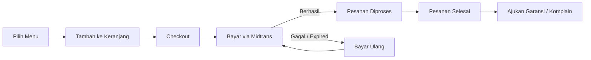

<div align="center">

# 🍱 Mama Alif Catering — Food Ordering System

Aplikasi web pemesanan catering online untuk **Mama Alif Catering** (Pondok Ungu Permai, Bekasi).
Pelanggan bisa memesan Nasi Box, Prasmanan, dan Nasi Tumpeng, membayar online lewat Midtrans, dan melacak status pesanan.


[🌐 Live Demo](https://link-demo-kamu.com) · [🐞 Laporkan Bug](../../issues) · [👤 Portfolio](https://alifrafi.vercel.app/)

</div>

---

## 📑 Daftar Isi

- [Tentang Proyek](#-tentang-proyek)
- [Fitur](#-fitur)
- [Screenshot](#-screenshot)
- [Tech Stack](#-tech-stack)
- [Struktur Database](#-struktur-database)
- [Instalasi](#-instalasi)
- [Konfigurasi Midtrans](#-konfigurasi-midtrans)
- [Akun Demo](#-akun-demo)
- [Alur Pemesanan](#-alur-pemesanan)
- [Deployment](#-deployment)
- [Roadmap](#-roadmap)
- [Kontak](#-kontak)

---

## 📖 Tentang Proyek

Sebelumnya pemesanan catering dilakukan secara manual lewat chat, sehingga rawan salah catat menu, jumlah porsi, dan tanggal acara. Aplikasi ini dibuat untuk:

- Menampilkan katalog menu beserta harga secara jelas
- Menyatukan pemesanan berbagai jenis menu dalam satu **keranjang**
- Memproses pembayaran online secara aman
- Memudahkan admin mengelola produk, pesanan, dan pelanggan

---

## ✨ Fitur

### 👥 Pelanggan
- Registrasi & login (halaman login dengan preview menu langsung)
- Katalog menu: **Nasi Box**, **Prasmanan**, dan **Nasi Tumpeng**
- Modal pemilihan menu per kategori dengan opsi yang menyesuaikan jenis menu
- Keranjang belanja terpadu untuk semua kategori
- Checkout multi-step dengan perhitungan harga otomatis (Livewire)
- Pembayaran online via **Midtrans Snap** (transfer bank, e-wallet, QRIS, dll.)
- Coba bayar ulang (retry) jika pembayaran gagal/kedaluwarsa
- Konfirmasi pesanan via WhatsApp
- Riwayat & status pesanan
- Pengajuan **garansi/komplain** setelah pesanan selesai

### 🛠️ Admin
- Dashboard admin (dilindungi middleware `EnsureUserIsAdmin`)
- CRUD produk dengan upload gambar
- Manajemen pesanan dengan filter status
- Manajemen pelanggan beserta riwayat pesanannya
- Penanganan komplain/garansi

### 🔒 Keamanan
- Harga selalu diambil dari database di server (mencegah manipulasi harga dari sisi klien)
- Proteksi CSRF bawaan Laravel
- Pembatasan akses berbasis role (customer / admin)

---

## 📸 Screenshot

> Simpan gambar di folder `docs/screenshots/` lalu sesuaikan nama filenya.

| Halaman Utama | Katalog Menu |
|:---:|:---:|
|  |  |

| Keranjang & Checkout | Pembayaran Midtrans |
|:---:|:---:|
|  |  |

| Dashboard Admin | Manajemen Pesanan |
|:---:|:---:|
|  |  |

---

## 🧰 Tech Stack

| Kategori | Teknologi |
|---|---|
| Backend | Laravel 12, PHP 8.3 |
| Frontend | Blade, Tailwind CSS, DaisyUI, Livewire |
| Database | MySQL |
| Payment Gateway | Midtrans Snap |
| Build Tool | Vite |
| Hosting | InfinityFree (shared hosting) |

---

## 🗄️ Struktur Database

Primary key menggunakan format `id_nama_tabel`.

| Tabel | Keterangan |
|---|---|
| `users` | Data pelanggan & admin (kolom `role`) |
| `products` | Data produk (Nasi Tumpeng) |
| `carts` | Keranjang belanja pelanggan (`id_cart`) |
| `orders` | Data pesanan & status pembayaran (`id_order`) |
| `order_items` | Detail item tiap pesanan |
| `complaints` | Pengajuan garansi/komplain |

> 💡 Tambahkan gambar ERD (`docs/erd.png`) agar struktur relasi lebih mudah dipahami.

---

## ⚙️ Instalasi

### Prasyarat
- PHP >= 8.3
- Composer
- Node.js & npm
- MySQL

### Langkah

```bash
# 1. Clone repository
git clone https://github.com/USERNAME/NAMA-REPO.git
cd NAMA-REPO

# 2. Install dependency
composer install
npm install

# 3. Salin file environment
cp .env.example .env

# 4. Generate application key
php artisan key:generate
```

Atur koneksi database di `.env`:

```env
DB_CONNECTION=mysql
DB_HOST=127.0.0.1
DB_PORT=3306
DB_DATABASE=mama_alif_catering
DB_USERNAME=root
DB_PASSWORD=
```

```bash
# 5. Jalankan migrasi
php artisan migrate

# 6. Import data produk awal (opsional)
#    Import file database/sql/data_awal.sql lewat phpMyAdmin

# 7. Buat symlink storage (untuk lokal)
php artisan storage:link

# 8. Jalankan aplikasi
npm run dev
php artisan serve
```

Buka `http://localhost:8000` di browser.

---

## 💳 Konfigurasi Midtrans

1. Daftar akun di [Midtrans Dashboard](https://dashboard.midtrans.com/) (gunakan mode **Sandbox** untuk testing).
2. Ambil **Server Key** dan **Client Key** dari menu *Settings → Access Keys*.
3. Isi di `.env`:

```env
MIDTRANS_SERVER_KEY=SB-Mid-server-xxxxxxxx
MIDTRANS_CLIENT_KEY=SB-Mid-client-xxxxxxxx
MIDTRANS_IS_PRODUCTION=false
MIDTRANS_IS_SANITIZED=true
MIDTRANS_IS_3DS=true
```

4. Atur **Payment Notification URL** di dashboard Midtrans ke:
   ```
   https://domain-kamu.com/midtrans/callback
   ```

> ⚠️ Jangan pernah commit Server Key ke repository.

---

## 🔑 Akun Demo

| Role | Email | Password |
|---|---|---|
| Admin | admin@example.com | password |
| Pelanggan | user@example.com | password |

---

## 🔄 Alur Pemesanan



---

## 🚀 Deployment

Aplikasi di-deploy ke **InfinityFree** (shared hosting). Catatan penting:

- Shared hosting tidak mendukung symlink, sehingga `php artisan storage:link` tidak bisa dipakai. Gambar produk disimpan langsung di folder `public/`.
- Jalankan `npm run build` di lokal, lalu upload folder `public/build`.
- Set `APP_ENV=production` dan `APP_DEBUG=false` di `.env` server.

---

## 🗺️ Roadmap

- [x] Keranjang terpadu untuk semua kategori menu
- [x] Integrasi Midtrans + retry pembayaran
- [x] Panel admin (produk, pesanan, pelanggan)
- [x] Sistem garansi/komplain
- [ ] Notifikasi email setelah pembayaran berhasil
- [ ] Laporan penjualan (export PDF/Excel)
- [ ] Semua kategori menu dikelola dari database

---

## 📬 Kontak

**Alif Rafi** — Web Developer

- 🌐 Portfolio: [alifrafi.vercel.app](https://alifrafi.vercel.app/)
- 📧 Email: alifra709@gmail.com

---

## 📄 Lisensi

Proyek ini dibuat untuk keperluan portfolio dan bisnis **Mama Alif Catering**.
Dibangun di atas framework [Laravel](https://laravel.com) yang berlisensi [MIT](https://opensource.org/licenses/MIT).
